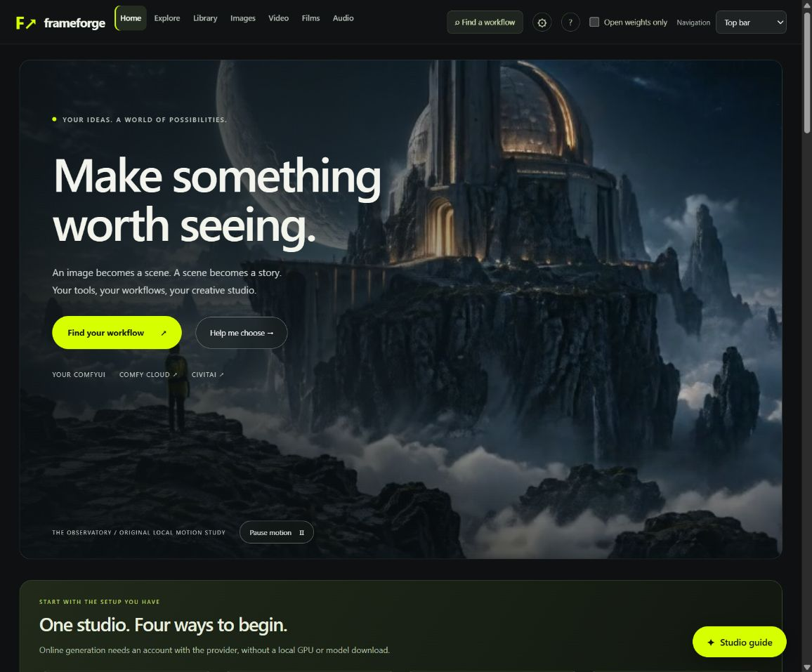

> **0.7.4:** Explore includes Civitai inspiration; Guide finds/chains workflows in the website and native MCP panel. Canvas Proof view shows actual changed pixels. Rough cut exports selected film clips without new generation. Video/audio ComfyUI return nodes and per-workflow download labels are included. Ten read-only MCP tools plus ten opt-in production tools. No paid generation is submitted automatically.

# Frameforge

Release **0.7.4** adds direct local LTX/H3/FLUX execution, reviewed model downloads, early dependency lists, per-assistant setup and a native ComfyUI image/video/audio bridge. See [the integration guide](INTEGRATION-UPGRADE.md) for tested profiles and remaining work.

**An open-source creative studio inspired by Higgsfield, built around ComfyUI workflows.**

Frameforge is a local creative studio over your own ComfyUI. Turn an idea into images, moving shots, voice and a short film through a guided browser interface. Inspect the actual workflow graph, understand its inputs, find the required models, and choose where to create.

*Actual browser screenshot of the studio. The cover uses original artwork and a short local Wan motion study; it is not a model-quality benchmark.*

## Why this exists

Creative AI tools offer an exciting path from an idea to a finished story. Setting up models, finding a compatible graph and connecting the results can make that path difficult to follow.

Frameforge brings those steps together: explained recipes, setup checks, editable ComfyUI graphs, saved media and a film workspace. It is an independent implementation inspired by Higgsfield's creative workflow. It is not affiliated with Higgsfield and does not include its source code, proprietary models or hosted service.

Built as an open-source Higgsfield-inspired creative studio submission.

### Canvas and connected workspaces

Images now includes a Canvas for paint/box edits, protected edge extension, original/result comparison and saved versions. A shared My work drawer reuses generated media and saved references across workspaces. Grouped tool cards and compact run/export controls bring the tools into view. The LTX recipe includes five selectable prompt packages; only its original smoke example is claimed as tested. See [Workspace guide and remaining work](WORKSPACE-GUIDE.md) for the complete flow, verification scope and remaining features.

## What you can do

| Workspace | What it helps you make |
| --- | --- |
| **Home** | Start with an idea, inspect actual local model results and explore Civitai examples, prompts and sources. |
| **Library** | Browse 20 distinct tasks, choose a model inside its task, and inspect graphs and downloads. My work holds saved results separately. |
| **Images** | Create and edit stills, paint masks, upscale, and organize character, scene and style references. |
| **Video** | Generate or edit a clip, then carry a film through Story, Director and Timeline. A project bar retains the working film and shot. |
| **Audio** | Prepare narration, dialogue, transcription and translation; explore experimental lip-sync tools. |
| **Studio guide & MCP** | Find workflows in the website, or connect Codex/Claude to the same graph, generation and saved-production tools. |

The interface has five primary destinations: Home, Library, Images, Video and Audio. Top bar and Side bar remain mutually exclusive, with a visible navigation switch and Local only toggle. [Workspace and handoff guide](WORKSPACE-GUIDE.md).

**One Studio guide:** Ctrl+K, the Home idea box and help buttons open the same side panel. Typing searches instantly without an LLM. Enter builds a suggested plan using guided matching or your explicitly selected local chat model. The plan stays open when following tool links. Connection settings live in Setup, and the guide cannot start media jobs or spend credits.

**A film stays in context:** save shot notes in Story, open Generate this shot, review the loaded brief and source, then render deliberately. Use selected clip for this shot attaches the checked result only to that shot. Stale saves are rejected; selection never grants creative approval. Director keeps a separate production plan until assembly.

## Website or MCP. Your choice.

The local STDIO MCP server gives Codex, Claude and compatible clients **20 tools** for workflow discovery, setup, editable graphs, local creation, saved playback, speech and film projects. Eight tools are read-only by default; creation needs `--allow-writes`. The native MCP Apps panel has visual workflows, generation, audio, timelines and saved results without loading a nested website or redirecting to a browser. Advanced audio/video requests and composition layers currently use JSON controls; it does not reproduce every specialized website editor. No paid submissions, automatic model installs or Cloud credentials. Native client acceptance is recorded separately from bridge-fixture checks. See [MCP setup and examples](MCP-GUIDE.md).

Use the navigation **Local only** toggle (the reviewed open-weights profile) to limit this studio to reviewed local pipelines. `npm run start:open` locks that profile; `--open-weights-only` does the same for an MCP connection. Partner nodes and unknown model loaders are rejected server-side. [Scope, model terms and limits](OPEN-WEIGHTS.md).

This entry is being prepared for the Comfy Open Source Higgsfield challenge. [Submission requirements and remaining owner actions](CHALLENGE-CHECKLIST.md) include a two-minute demo, social link, signup and entry form. The profile is not an organizer eligibility certification.

**Inside ComfyUI:** install the bundled [ComfyUI extension](assets/comfyui-frameforge/README.md), start both apps and open the Frameforge sidebar entry. The complete running website works in Studio or beside your graph in Split view. Images, Video, Audio, Library, Guide and model checks use the same local Studio and saved work. Quick tools jump straight to video, image and audio controls. Export the current native graph from the compact toolbar, or send a prepared Studio graph and its checked inputs into a separate ComfyUI tab. Three output nodes send saved IMAGE, VIDEO or AUDIO results straight into its embedded editors. External Cloud/Civitai sign-in stays on the provider website.

## Four ways to start

| Your setup | How it works |
| --- | --- |
| **You already use ComfyUI** | Start it, choose **Setup & models → Find running ComfyUI**, select its address and check the recipe. Existing model folders can stay where they are. |
| **You want a local installation** | Follow the official ComfyUI install links, then download only the selected workflow's requirements. Native graphs include missing-model download metadata. |
| **You want Comfy Cloud only** | Choose **Create online**, download a graph and import it into your own Comfy Cloud account. Supported text-only image, video and speech graphs prepare without local ComfyUI, Python or model weights. |
| **You want Civitai images** | Prepare a prompt/model-reference brief, open Civitai's generator, choose a supported model and review the Buzz cost there. |

Cloud and Civitai generation happen on those services. Frameforge does not store provider credentials, upload your media or spend credits. Reference-based Cloud starter graphs require replacing example inputs; native graphs require matching nodes/models in the destination environment. A Civitai brief is a text handoff, not an importable ComfyUI graph.

## Quick start

Install [Node.js 22 or newer](https://nodejs.org/en/download), then:

    git clone https://github.com/RahmelJackson/frameforge-studio.git
    cd frameforge-studio
    npm start

Open **http://127.0.0.1:4317** and choose a setup path. The interface has no npm dependencies to install. Browse workflows and prepare supported online graphs before connecting a local engine.

For uploads and media checks **inside the studio**, install [Python 3.12](https://www.python.org/downloads/) and run:

    npm run setup:media

Restart the studio afterward. This installs only CPU media helpers, not ComfyUI, Torch or model weights. Advanced speech, segmentation and finishing tools have separate setup requirements. Local generation needs the selected recipe's hardware, models and nodes. The full bundled-engine setup scripts target Windows; the Node interface and external handoffs do not require that installation.

See [the detailed setup guide](GITHUB-SETUP.md) for model folders, another drive, optional local AI and MCP configuration.

## How the pieces fit

    Idea / reference / clip
             ↓
    Guided tool + explained recipe
             ↓
    Inspect / edit / export the workflow
             ↓
    Local ComfyUI  OR  external Comfy Cloud / Civitai
             ↓
    Save and review the result
             ↓
    Edit / assemble / add sound and captions / export

Some tasks are ComfyUI graphs; others use local Python media processors. Where a tool has several stages, the studio shows their roles instead of representing the whole pipeline as a single portable graph. Suggested chains still require choosing, running and reviewing each stage.

## Current state and limits

This is a working prototype. Run `npm test` for the current application regression checks. Local image/video workflows, graph export, saved projects, media checks and a demonstration film export have retained verification records. A separate empty-model ComfyUI instance verifies that importing the Z-Image graph exposes its three dependencies and download controls.

Technical checks do not guarantee a convincing creative result. Fifteen broader quality goals remain parked, including difficult character consistency, swaps, motion/occlusion, advanced relighting and speech/lip realism. Some tools have narrow acceptance or remain experimental; the [saved checklist](REMAINING-CHECKLIST.md) records those limits.

Provider account-side Cloud imports/runs and Civitai generation still need acceptance checks. API/node/model availability can change. Civitai media may be blocked by the browser; original source links remain available. There are no model weights, personal outputs, Python environments or provider keys in this repository.

## Development and verification

    npm test                # Application regression tests
    npm run verify          # Running studio + installed local engine readiness; no render
    npm run package:source  # Clean source archive and SHA-256 inventory

The readiness check needs the studio and configured engine running and is not expected to pass before local model setup. Media integration tests explicitly skip when their optional Python runtime is absent. They run, and must pass, when that runtime is installed. A passing source-only suite does not prove GPU generation quality. Follow [the verification loop](BUILD-LOOP.md) when changing generation behavior; watch/listen to real outputs separately from automated checks.

The server binds to localhost and is intended for personal local use. Public repository access does not make the running application a hosted multi-user service.

## License and credits

Original project code is [MIT licensed](LICENSE). ComfyUI, custom nodes, optional tools, model weights, hosted services and third-party templates keep their own terms. Preserve the included [third-party notices](THIRD-PARTY-NOTICES.md).

Built around the work of [ComfyUI](https://github.com/Comfy-Org/ComfyUI) and its workflow ecosystem, with optional [Ollama](https://ollama.com/) integration and [Civitai](https://civitai.com/) discovery links. Higgsfield is a product inspiration, not a project dependency or affiliation.

**Bring your own AI:** Ollama is optional. Studio guide connects to LM Studio, Ollama, llama.cpp, vLLM and custom local compatible servers. Setup includes server presets, discovery and copy/download configuration for Antigravity, Hermes Agent, LM Studio and Claude MCP clients. [Connection guide and tested scope](ASSISTANT-CONNECTIONS.md).

**Install as a plugin:** Frameforge also packages a branded local/community plugin with starter prompts, onboarding, creative skills and its visual MCP studio. Add the GitHub marketplace, install `frameforge-studio@frameforge-community`, then restart your client. Node.js 22+ is required; models remain separate. [Plugin installation, permissions and public-listing limits](PLUGIN-GUIDE.md).

See [review follow-up](REVIEW-FIXES.md) for the completed usability fixes, plus remaining portability work.

## Select before editing

**Select before editing:** Image Canvas supports native SAM 3.1 selection by text, box or keep/exclude points, plus brush/eraser touch-ups. It saves a lossless PNG mask for protected Qwen edits. One checkpoint is listed with its model download/source link; no model is bundled. Inspect selections, especially box edges and absent-object prompts. [Workflow and acceptance scope](WORKSPACE-GUIDE.md#sam-image-selection).

Workflow availability is tracked in the [suggested-workflow audit](WORKSPACE-GUIDE.md#suggested-workflows-current-coverage). 3D generation, generated music, LoRA training and other planned capabilities are not advertised as working tools.

The Library groups 42 creative tasks with local/Cloud options inside each card. Images, Video and Audio share visible creation controls and a result preview; Audio adds real waveforms and timed transcript navigation. See [layout, task coverage and native-editor handoff limits](WORKSPACE-GUIDE.md#shared-creation-layout-and-library-coverage).

## Creative recipes (0.8.0)

Open **Video → Creative recipes** (`/recipes`) for performance variations, a product campaign, source-video shot planning or saved-motion remix. Save a subject and shared direction, inspect the actual workflows, then explicitly render a preview or sequential variations. Sources and seed choices are frozen in the saved plan. Use the original samples to try the interface without finding files first.

`studio_recipe_library` reads the same subjects, motions, plans and batch states; `capabilities: true` reports supported recipes and current readiness. `studio_recipe` provides opt-in save, prepare, frame extraction, Director handoff and sequential queue operations. The MCP connection still defaults to read-only. A queue requires a saved-plan signature and a request ID; reuse the request after an ambiguous result. No result is automatically creatively approved.

Canvas offers Qwen and installed FLUX 3 Image Klein. The FLUX masked graph crops the selection, generates the edit, resizes it to the crop and composites through the mask on the source grid. Native graph downloads include both image inputs and the mask. Proof measures actual changed pixels, not identity or visual quality.

The source-reference recipe uses real decoded frames and your shot notes. It does not automatically understand video. Character/performance and motion-transfer quality remain subject to review.
