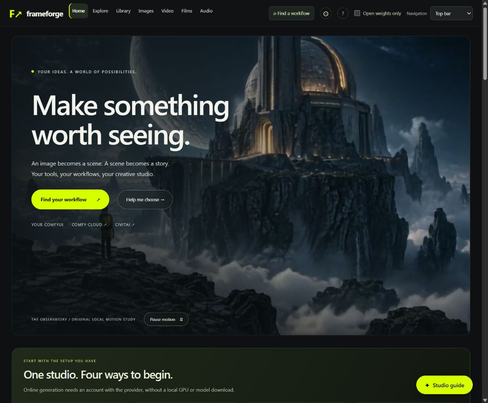

# Frameforge Studio

**An open-source creative studio inspired by Higgsfield, built around ComfyUI workflows.**

Frameforge is a local creative studio over your own ComfyUI. Make images, video, voice and short films, inspect the graphs behind them, and reuse your work across tools. Connect through a browser, a ComfyUI toolbar, or a visual MCP panel in a supported assistant.

## Start here

1. [Download the source ZIP](https://github.com/RahmelJackson/frameforge-studio/archive/refs/heads/main.zip) and **extract the entire folder**.
2. **Windows:** double-click **Start Frameforge.cmd**. **macOS/Linux:** open **Start Frameforge.command**, or run `sh 'Start Frameforge.command'`.
3. Choose **I have ComfyUI**, **I'm starting fresh**, or **I'll create online**. Click **Check my setup** for a readable dependency report.

Keep the extracted folder. The launcher reuses Node.js 22+ or downloads a pinned, checksum-verified private Node runtime. No admin access, global npm installation or model download is required to open Studio. If the browser does not open, use the address printed in the launcher window.

**macOS:** downloaded command files may require right-click → Open. If the OS still blocks the file, use the terminal command above after reviewing the source. Windows has been tested locally; native macOS/Linux acceptance remains open.



An actual Studio screenshot. The cover is original artwork with a short local Wan motion study, not a quality benchmark.

## Choose your way to create

| Use it through | What to do | What is required |
| --- | --- | --- |
| **Your ComfyUI** | Start your engine, then Settings → Find running ComfyUI | Compatible nodes, model files and hardware for the selected workflow |
| **Comfy Cloud** | Open the linked official template, or download/import a prepared graph | Your own provider account and credits; destination node/model support |
| **Civitai** | Explore a credited example, prepare a prompt/reference brief and open its generator | Your own account, a supported model and Buzz; this is an external text handoff |
| **Claude / Codex / other MCP clients** | Settings → Use from Claude or Codex → Copy connection | A supported MCP client; copied setup uses Studio's actual Node executable and address |
| **Inside ComfyUI** | Settings → ComfyUI handoff → install the extension | Your existing ComfyUI; Quick tools opens first, with a switch to full Studio |

Cloud and Civitai generation happen in your account on their websites. Frameforge does not store their credentials or spend credits. Opening a link does not silently upload inputs or import an edited graph. Custom published Cloud App Mode links and account-side generation still need provider-side acceptance.

## What you can make

| Workspace | Start with |
| --- | --- |
| **Explore** | An idea, actual local model examples, or credited Civitai inspiration |
| **Images** | Generate a still, edit on Canvas, select with SAM, extend edges or organize references |
| **Video** | Animate a still, create/edit a shot, then use Story, Director and Timeline to assemble a film |
| **Audio** | Narration, dialogue, transcripts and subtitles; additional speech tools have separate requirements |
| **Library** | Distinct workflow tasks, creative recipes and your saved results |
| **Advanced** | A textured 3D prop, precision tools and character training preparation |

- **See the graph:** inspect, edit and export real ComfyUI graphs, with source and model links.
- **Find the right workflow:** Search / Ctrl+K opens Guide. Catalog matching works without an LLM. Optionally connect your own supported chat endpoint; Ollama is not mandatory. Guide proposes steps and links, and does not start paid or local renders itself.
- **Keep creating:** My work reuses saved media. Proof view compares actual pixels. Rough cut turns selected clips into a draft film without generating new shots.
- **Build on a creative canvas:** arrange images, clips and GLBs, save a 3D camera, capture a still or record an orbit. Carry a reference into editing, animation and reusable cast records.
- **Produce: one idea → a finished video.** Video → Produce plans the shots for a format, renders every keyframe and clip on your ComfyUI one at a time, records Kokoro narration, adds captions and exports a rough cut. It stops for your review after keyframes and after clips (or runs straight through), lets you remake any single shot, and can be driven by your assistant through the `studio_produce` MCP tool.
- **Move a character with your own motion:** Wan Animate 2 (full and fast) turns a clip of you moving plus a picture of an original character into the character performing it. Experimental SCAIL-2 replaces a person in a video. Stable Audio 3 adds sound effects, ambience and music from words.
- **Start from a template:** Library → Templates lists basic workflows (each opens locally in ComfyUI or as the same official template on Comfy Cloud) and popular video formats.
- **Start with a format:** explainer with sources, Life as a…, short drama episode, fruit drama, What if…, transformation, satisfying loop, an experimental single-mic duet, plus narrative and product stories, create timed 15/30/60-second plans. Reuse a saved cast, then make the selected clips into a film.
- **Finish a version:** CPU grades, audio-preserving transitions and silent MP4/GIF loops reuse existing clips. Export a film as an editable OTIO/media package. [Exact scope and steps](CREATIVE-WORKSPACE.md).
- **Loop, restyle and finish:** make seamless H3 loops with matching sound, restyle an existing loop through H3 ControlNet, match a reference image's style with Qwen 2511, upscale video with SeedVR2 or Real-ESRGAN, and turn a 3D layout into a shot with LTX Layout to Render. These are pinned graphs prepared in Studio and run in ComfyUI; check each workflow's listed nodes and files first.
- **Prepare a character LoRA:** export captioned training images, a separate held-out set and either a FLUX.1/AI Toolkit starter config or an experimental FLUX 3 Klein command for the official diffusers trainer, or train the FLUX 3 Klein LoRA right in Studio: one-click trainer install, progress, cancel, and the result lands in ComfyUI's loras folder. A trainer and the matching base model are separate; Frameforge does not run training yet.
- **Use your assistant:** the STDIO MCP server supports discovery, requirements, graphs, local generation and production tools. Its native MCP Apps panel has visual workflows and saved results; it is not a nested website. Some advanced controls use JSON rather than the website's specialized editors.
- **Stay with open weights:** the header's Open weights pill restricts execution to reviewed local graphs/processors and hides partner routes. Model licenses still apply. Change the top/side layout in Settings.

Local LTX 2.5, FLUX 3 Image Klein and H3 samples have saved render evidence. The TRELLIS.2 3D preview, BiRefNet RGBA cutout and FLUX reference/layout edit were also run locally. Other native recipe imports are labelled as needing a render check; graph validity is not proof of output quality. Local LTX recipe exports select the int8 core weights and direct local prompts, without an API branch or an extra prompt-enhancer model.

## Dependencies, without guessing

| Component | When you need it | How Studio helps |
| --- | --- | --- |
| **Node.js 22+** | Always, to serve the local interface | The launcher can fetch a private verified runtime |
| **CPU media helpers** | Studio uploads, previews and export checks | Welcome → Install media tools fetches isolated Python 3.12 and pinned packages; it keeps ComfyUI's Python unchanged |
| **ComfyUI + model weights** | Local graph execution | Check the selected workflow; inspect files, sizes, licenses, existing files and exact destinations before downloading only its missing files |
| **Custom nodes / advanced processors** | Only for recipes that use them | Requirements list missing node types and sources; advanced GPU Python installers remain Windows-focused |
| **A chat model** | Optional LLM-backed Guide | Guided catalog search works without one |
| **MCP host runtime** | Assistant connection | Use Copy connection first if Node is private; the marketplace's static `node` command needs Node on PATH |

Models can go directly in **ComfyUI's models folder**, or in a **shared folder**. For a shared folder, download the generated `extra_model_paths.yaml`, add it to your ComfyUI configuration and restart the idle engine. ComfyUI can then see the same weights without copying them. Existing files found through registered model paths are reused; switching a destination does not move them. Native ComfyUI graph exports also include missing-model metadata. Gated downloads require accepting the original provider's terms.

For a terminal report, run `npm run doctor`. To check one local recipe, run `npm run doctor -- --workflow wan-i2v`. These commands inspect only; they install nothing and run no inference. Missing optional software does not prevent browsing or external handoffs.

## Manual development

```sh
git clone https://github.com/RahmelJackson/frameforge-studio.git
cd frameforge-studio
npm run quickstart
```

No npm package install is needed for the core server. `npm start` serves it directly. `npm run setup:media` installs isolated CPU helpers. `npm test` runs the checks; optional runtime-dependent checks may skip in a clean source checkout. Stop an idle launcher-owned Studio with **Stop Frameforge.cmd** or `node scripts/quickstart.mjs --stop`; this leaves ComfyUI running.

The raw MCP server is read-only unless started with `--allow-writes`. The bundled marketplace plugin explicitly includes that flag so requested local creation works. Your client's tool approvals still apply. Neither connection provides shell execution, automatic model installation, paid submissions or creative approval.

## Learn more

[Quick start and recovery](QUICKSTART.md) · [Detailed setup](GITHUB-SETUP.md) · [Workspace guide](WORKSPACE-GUIDE.md) · [MCP setup](MCP-GUIDE.md) · [Integration scope](INTEGRATION-UPGRADE.md) · [Open weights and terms](OPEN-WEIGHTS.md) · [Remaining checklist](REMAINING-CHECKLIST.md)

Release **0.9.0**. Original code is MIT licensed. Models, upstream graphs and third-party components retain their own terms; see [notices](THIRD-PARTY-NOTICES.md). The source release excludes model weights, personal media, machine settings, credentials and private judge deployments. Frameforge is independent of Higgsfield and includes none of its proprietary source or hosted service.
